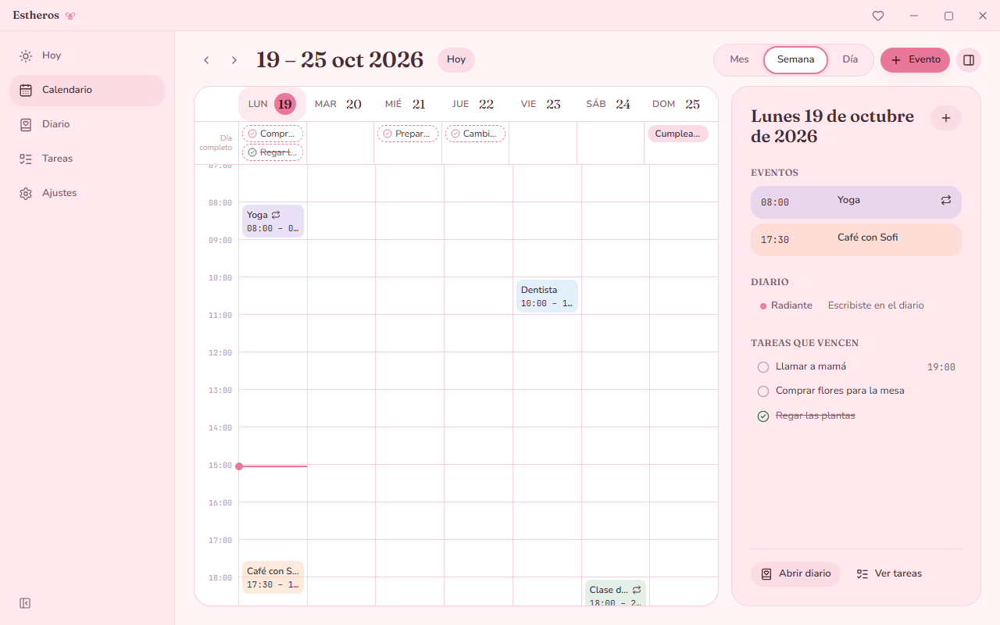
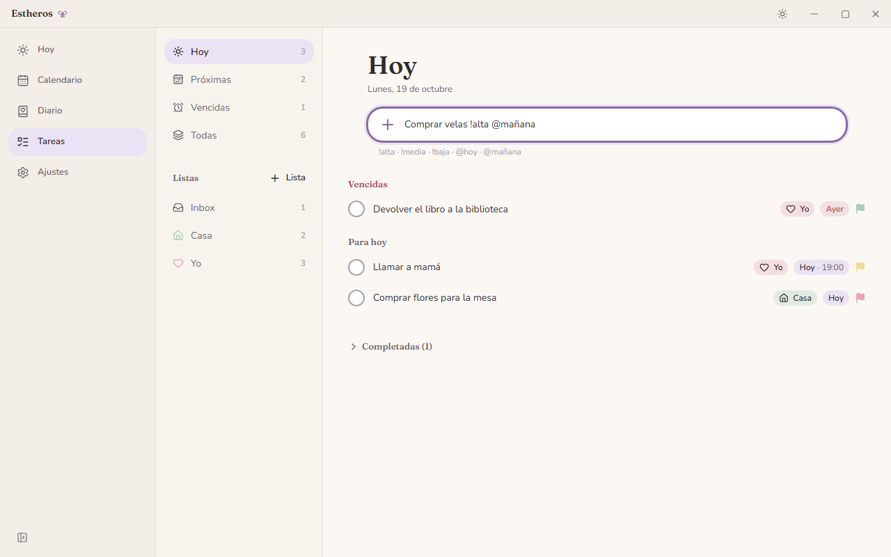
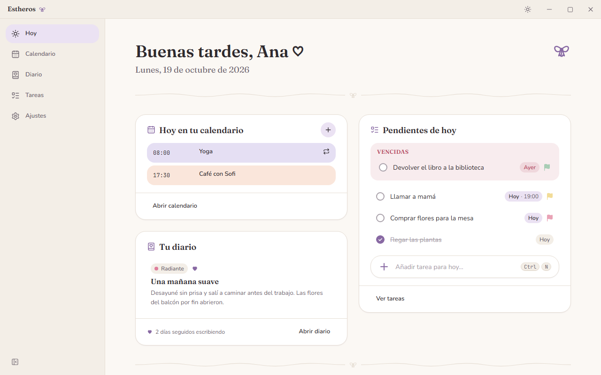
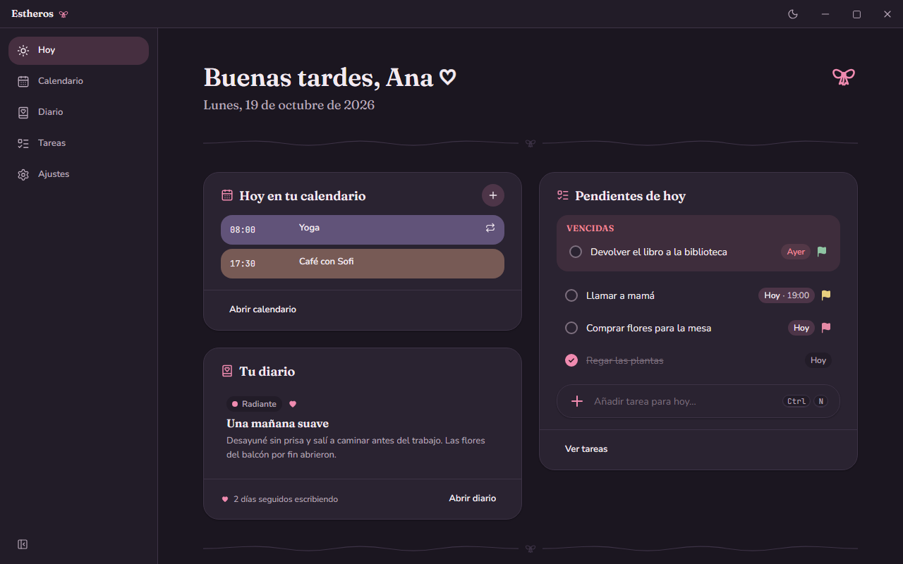
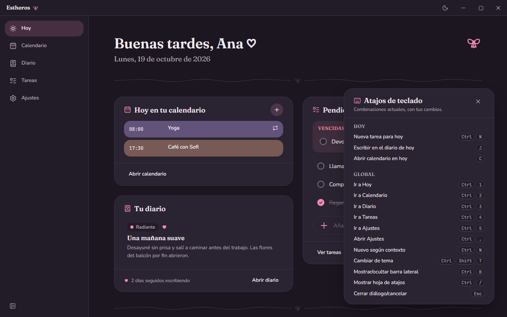
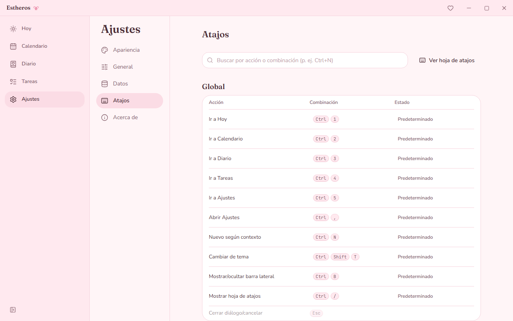
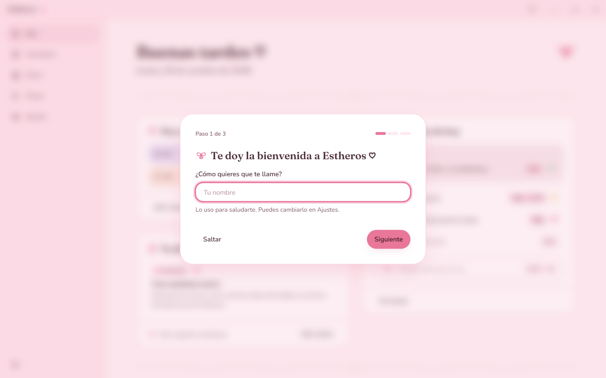

<p align="center">
  
</p>

<h1 align="center">Estheros</h1>

<p align="center">
  <strong>Tu calendario, tu diario y tus tareas en un rincón tranquilo ♡</strong>
</p>

<p align="center">
  <a href="https://github.com/Micoh18/EstherOS/releases/latest"></a>
  
  <a href="LICENSE"></a>
  
</p>

<p align="center">
  <a href="https://github.com/Micoh18/EstherOS/releases/latest"><strong>⬇ Descargar para Windows</strong></a>
  ·
  <a href="#características">Características</a>
  ·
  <a href="#instalación">Instalación</a>
  ·
  <a href="#desarrollo">Desarrollo</a>
</p>

<p align="center">
  
</p>

Estheros es una app de escritorio para Windows que reúne en un solo lugar **calendario**, **diario** y **lista de tareas**, con una estética cozy y coquette pensada para que organizar el día se sienta agradable. Funciona **sin cuenta y sin internet**: todos tus datos se guardan en tu equipo, en una base de datos local que puedes exportar cuando quieras.

- **Ligera:** el instalador pesa unos 3 MB y la app abre en alrededor de un segundo.
- **Privada:** sin telemetría, sin servidores y sin registro. Tus datos son un archivo tuyo.
- **Con teclado:** cada acción tiene atajo, y puedes reasignarlos todos.

## Características

### Hoy: tu día de un vistazo

La pantalla de inicio te saluda por tu nombre y reúne lo importante del día: los eventos del calendario, las tareas pendientes (con las vencidas aparte), la entrada de diario de hoy con su estado de ánimo y tu racha escribiendo, y lo que viene mañana. Se actualiza sola a medianoche y cuando vuelves a la ventana.

### Calendario

Vistas de **mes, semana y día**. Eventos con hora o de día completo, seis colores, etiquetas, lugar y repeticiones (diaria, semanal, mensual o anual). Crea eventos haciendo clic o arrastrando en la rejilla, muévelos entre días y registra también cosas que ya pasaron. Las tareas con fecha y los días con diario aparecen en el calendario, y el panel lateral resume cada día.

| Mes (Dark)                                                    | Semana (Pink)                                                         |
| ------------------------------------------------------------- | --------------------------------------------------------------------- |
|  |  |

### Diario

Una o varias entradas por día con **editor de texto enriquecido** (títulos, negrita, listas, citas y enlaces) y guardado automático. Marca tu **estado de ánimo**, guarda favoritas, añade etiquetas y encuentra cualquier recuerdo con la búsqueda y el mini calendario.

<p align="center">
  
</p>

### Tareas

Escribe la tarea y añade la prioridad y la fecha en el mismo texto: `Comprar velas !alta @mañana`. Organiza en listas con color e icono, añade subtareas, notas y hora, y trabaja con las vistas **Hoy, Próximas, Vencidas y Todas**. Ordena arrastrando o con el teclado; al completar una tarea hay una pequeña celebración ♡.

| Listas y vistas (Pink)                              | Captura rápida (White)                                                              |
| --------------------------------------------------- | ----------------------------------------------------------------------------------- |
|  |  |

### Tres temas

**Pink**, **White** y **Dark**, o **Sistema** para seguir el modo claro u oscuro de Windows. El cambio es instantáneo y sin parpadeos. También puedes ajustar el tamaño del texto y reducir las animaciones.

| Pink                                            | White                                             | Dark                                            |
| ----------------------------------------------- | ------------------------------------------------- | ----------------------------------------------- |
|  |  |  |

### Atajos de teclado

Navega con `Ctrl+1…5`, crea con `Ctrl+N`, cambia de tema con `Ctrl+Shift+T` y usa acordes como `G` `H` para saltar entre vistas. `Ctrl+/` muestra la hoja con los atajos de la pantalla en la que estás, y desde **Ajustes → Atajos** puedes reasignar cualquiera, con detección de conflictos.

| Hoja de atajos (Dark)                                    | Atajos reasignables (Pink)                                           |
| -------------------------------------------------------- | -------------------------------------------------------------------- |
|  |  |

### Ajustes, bienvenida y copias de seguridad

La primera vez, una bienvenida de tres pasos te pide tu nombre y tu tema. En **Ajustes** eliges inicio de semana, formato de hora, vista de calendario y pantalla de inicio; gestionas las etiquetas compartidas; y en **Datos** exportas una copia completa a un archivo `.db` o importas una anterior. Antes de importar se valida el archivo y se guarda una copia automática de lo que tenías.

| Bienvenida                                                        | Ajustes (White)                                                 |
| ----------------------------------------------------------------- | --------------------------------------------------------------- |
|  |  |

## Instalación

### Requisitos

- Windows 10 o Windows 11 de 64 bits.
- WebView2 Runtime. Viene con Windows 11 y con Windows 10 actualizado; si falta, el instalador lo descarga (solo en ese momento hace falta conexión).

### Pasos

1. Descarga **`Estheros_1.0.0_x64-setup.exe`** desde la [página de releases](https://github.com/Micoh18/EstherOS/releases/latest).
2. Ábrelo. Se instala solo para tu usuario y no pide permisos de administrador.
3. Busca **Estheros** en el menú Inicio o en el escritorio.

Si prefieres instalar para todo el equipo, usa `Estheros_1.0.0_x64_es-ES.msi` (pide permisos de administrador). Cada release publica el SHA-256 de los instaladores para que puedas comprobar la descarga.

### Aviso de Windows SmartScreen

El instalador todavía no está firmado digitalmente, así que la primera vez Windows puede mostrar «Windows protegió su PC». Para continuar:

1. Pulsa **Más información**.
2. Comprueba que el archivo es el que descargaste de este repositorio.
3. Pulsa **Ejecutar de todas formas**.

### Tus datos

Todo se guarda en `%APPDATA%\com.estheros.desktop\estheros.db`. Desde **Ajustes → Datos** puedes ver la ruta, abrir la carpeta y exportar una copia antes de cambiar de equipo.

Al desinstalar se borra la app pero no tus datos, por si vuelves. Si quieres eliminarlos también, borra esa carpeta.

## Desarrollo

### Stack

| Capa       | Tecnología                                                  |
| ---------- | ----------------------------------------------------------- |
| Escritorio | [Tauri 2](https://tauri.app) (Rust) con WebView2            |
| Interfaz   | React 19, TypeScript, Vite                                  |
| Estilos    | Tailwind CSS v4 con tokens de diseño por tema               |
| Animación  | Framer Motion                                               |
| Editor     | Tiptap                                                      |
| Estado     | Zustand                                                     |
| Datos      | SQLite local (plugin SQL de Tauri y sqlx) con migraciones   |
| Tests      | Vitest + Testing Library, Playwright para e2e, `cargo test` |

### Requisitos

- Node.js 22 o superior y npm 11.
- Rust stable (toolchain MSVC) instalado con `rustup`.
- Visual Studio Build Tools con la carga de trabajo «Desarrollo para el escritorio con C++».

### Primeros pasos

```bash
npm install
npm run tauri dev
```

La primera compilación de Rust tarda varios minutos; las siguientes son incrementales.

### Comandos

| Comando                               | Qué hace                                                                      |
| ------------------------------------- | ----------------------------------------------------------------------------- |
| `npm run tauri dev`                   | Arranca la app de escritorio en modo desarrollo                               |
| `npm run dev`                         | Solo el frontend en Vite (`http://localhost:1420`)                            |
| `npm run tauri build`                 | Genera los instaladores `.msi` y `.exe` en `src-tauri/target/release/bundle/` |
| `npm run check`                       | Typecheck + lint + tests unitarios                                            |
| `npm test`                            | Tests unitarios (Vitest)                                                      |
| `npm run e2e`                         | Smoke tests end-to-end (Playwright) contra el servidor de Vite                |
| `npm run format`                      | Prettier sobre todo el proyecto                                               |
| `npm run tauri icon <png de 1024 px>` | Regenera todos los iconos a partir de una imagen                              |

Antes de cada commit, Husky ejecuta lint-staged (ESLint con `--fix` y Prettier sobre los archivos preparados).

### Tests end-to-end y capturas

Los smoke tests de `tests/e2e/` abren la app en Chromium contra Vite. Un backend falso en Node sustituye al lado Rust y responde a las mismas llamadas IPC con una base SQLite creada con la migración real, así que los repositorios ejecutan su SQL de verdad.

```bash
npx playwright install chromium   # solo la primera vez
npm run e2e
```

Las capturas de este README se generan con datos de ejemplo:

```bash
SCREENSHOTS=1 npx playwright test
```

### Estructura

```
src/
  app/        bootstrap, router, providers, layout del shell y pantalla de error
  features/   today, calendar, journal, todo, settings, onboarding
  shared/     ui, theme, db, hotkeys, i18n, lib, icons
  styles/     globals.css (Tailwind v4 + tokens) y fuentes
src-tauri/    backend Rust, migraciones SQL, configuración de Tauri e iconos
tests/        unit/ (Vitest) y e2e/ (Playwright)
assets/       icono y capturas de este README
```

Los commits siguen Conventional Commits (`feat(todo): …`, `fix(calendar): …`), con un scope por feature. Los cambios de cada versión están en el [CHANGELOG](CHANGELOG.md).

## Licencia

Estheros se distribuye con la [licencia MIT](LICENSE) © 2026 Micoh18.

Las tipografías Fraunces, Nunito y JetBrains Mono se incluyen con la SIL Open Font License 1.1 (ver `src/styles/fonts/`). Iconos de interfaz: [Lucide](https://lucide.dev), licencia ISC.
