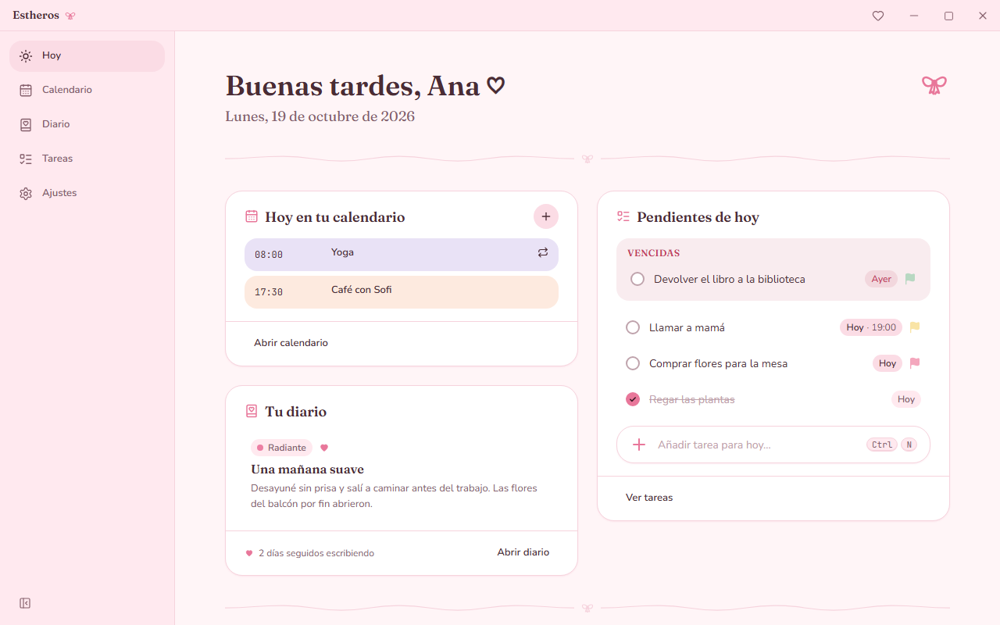
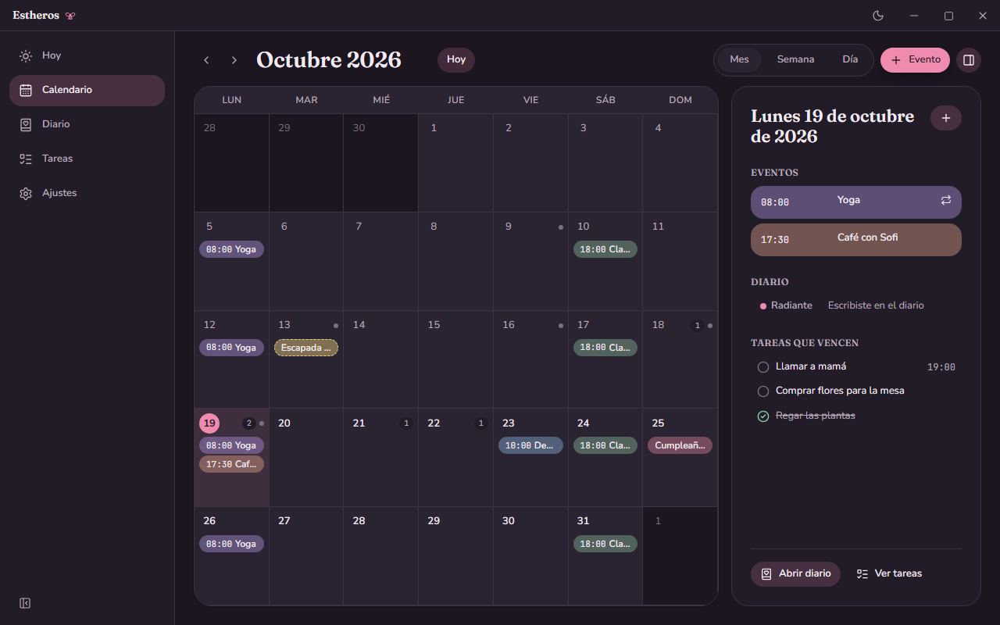
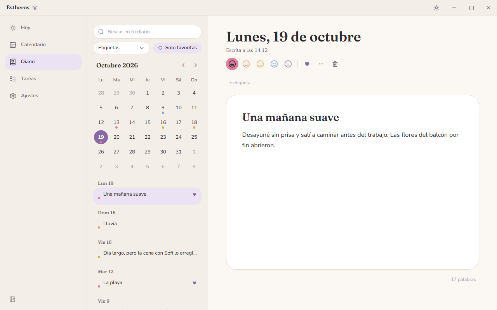
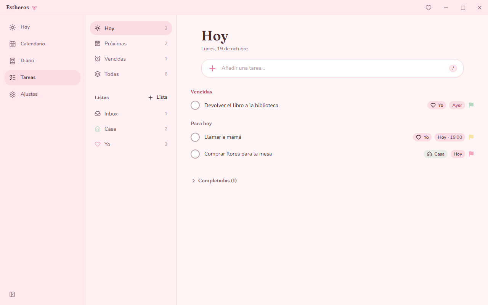
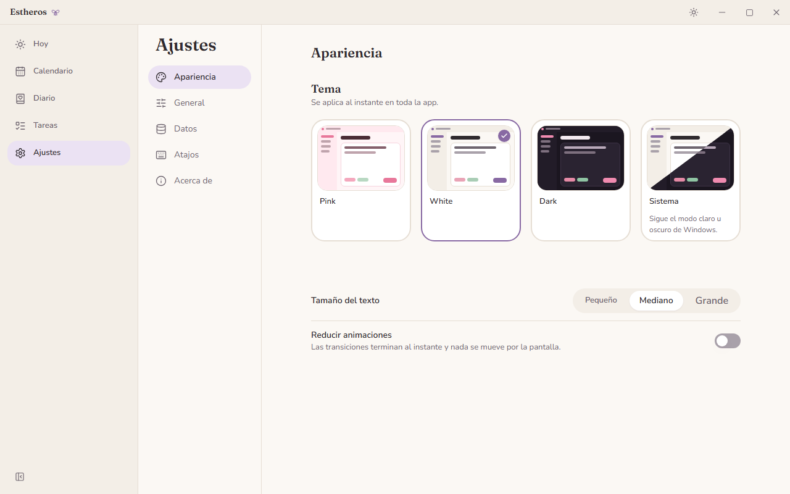

<p align="center">
  
</p>

<h1 align="center">Estheros</h1>

<p align="center">Un rincón tranquilo para tus días ♡</p>

Estheros es una app de escritorio para Windows que reúne en un solo lugar tu **calendario**, tu **diario** y tu **lista de tareas**, con una estética cozy y coquette. No necesita cuenta ni internet: todo se guarda en tu equipo.



## Qué puedes hacer

- **Hoy**: un resumen del día con tus eventos, tus pendientes (y lo que se quedó atrás) y la entrada de diario de hoy.
- **Calendario**: vistas de mes, semana y día; eventos con hora o de día completo, repeticiones simples y registro de lo que ya pasó.
- **Diario**: una o varias entradas por día con texto enriquecido, estado de ánimo, favoritas, etiquetas y búsqueda.
- **Tareas**: captura rápida con prioridad y fecha en el mismo texto (`Comprar flores !alta @mañana`), listas, subtareas y vistas Hoy, Próximas y Vencidas.
- **Temas**: Pink, White y Dark, o «Sistema» para seguir el modo de Windows.
- **Atajos de teclado** para casi todo, reasignables desde Ajustes.
- **Copias de seguridad**: exporta e importa todos tus datos en un archivo.

| Calendario (Dark)                                           | Diario (White)                                             |
| ----------------------------------------------------------- | ---------------------------------------------------------- |
|  |    |
| **Tareas (Pink)**                                           | **Ajustes (White)**                                        |
|          |  |

## Requisitos

- Windows 10 o Windows 11 de 64 bits.
- WebView2 Runtime. Ya viene con Windows 11 y con Windows 10 actualizado; si falta, el instalador lo descarga (hace falta conexión solo en ese momento).

## Instalación

1. Descarga `Estheros_1.0.0_x64-setup.exe` de la página de releases.
2. Ábrelo. Se instala solo para tu usuario y no pide permisos de administrador.
3. Busca **Estheros** en el menú Inicio o en el escritorio.

También hay un `Estheros_1.0.0_x64_es-ES.msi` para instalar en todo el equipo. Ese sí pide permisos de administrador.

### Aviso de Windows SmartScreen

El instalador todavía no está firmado digitalmente, así que la primera vez Windows puede mostrar «Windows protegió su PC». Para continuar:

1. Pulsa **Más información**.
2. Comprueba que el nombre del archivo es el que descargaste.
3. Pulsa **Ejecutar de todas formas**.

Descarga Estheros solo de la página oficial de releases.

### Tus datos

Todo se guarda en `%APPDATA%\com.estheros.desktop\estheros.db`. Puedes verlo y abrir la carpeta desde **Ajustes → Datos**, y desde ahí exportar una copia antes de cambiar de equipo.

Al desinstalar se borra la app pero no tus datos, por si vuelves a instalarla. Si quieres eliminarlos también, borra esa carpeta a mano.

## Desarrollo

### Requisitos

- Node.js 22 o superior y npm 11.
- Rust stable (toolchain MSVC) instalado con `rustup`.
- Visual Studio Build Tools con la carga de trabajo "Desarrollo para el escritorio con C++".

### Primeros pasos

```bash
npm install
npm run tauri dev
```

La primera compilación de Rust tarda varios minutos; las siguientes son incrementales.

### Comandos

| Comando                               | Qué hace                                                                      |
| ------------------------------------- | ----------------------------------------------------------------------------- |
| `npm run tauri dev`                   | Arranca la app de escritorio en modo desarrollo                               |
| `npm run dev`                         | Solo el frontend en Vite (`http://localhost:1420`)                            |
| `npm run build`                       | Typecheck y build del frontend en `dist/`                                     |
| `npm run tauri build`                 | Genera los instaladores `.msi` y `.exe` en `src-tauri/target/release/bundle/` |
| `npm run tauri icon <png de 1024 px>` | Regenera todos los iconos a partir de una imagen                              |
| `npm run check`                       | Typecheck + lint + tests unitarios                                            |
| `npm run typecheck`                   | Solo TypeScript                                                               |
| `npm run lint`                        | ESLint                                                                        |
| `npm run format`                      | Prettier sobre todo el proyecto                                               |
| `npm test`                            | Tests unitarios (Vitest)                                                      |
| `npm run test:watch`                  | Vitest en modo watch                                                          |
| `npm run e2e`                         | Smoke tests end-to-end (Playwright) contra el servidor de Vite                |

Antes de cada commit, Husky ejecuta lint-staged (ESLint con `--fix` y Prettier sobre los archivos preparados).

### Tests end-to-end

Los smoke tests de `tests/e2e/` abren la app en Chromium contra Vite, en el puerto 1440 (`E2E_PORT` para cambiarlo). Un backend falso en Node sustituye al lado Rust: responde a las mismas llamadas IPC con una base SQLite creada con la migración real, de modo que los repositorios ejecutan su SQL de verdad. Los diálogos nativos de archivo los responde el test.

```bash
npx playwright install chromium   # solo la primera vez
npm run e2e
```

Las capturas de este README salen de `tests/e2e/screenshots.spec.ts` con datos de ejemplo:

```bash
SCREENSHOTS=1 npx playwright test
```

### Estructura

```
src/
  app/        bootstrap, router, providers y layout del shell
  features/   today, calendar, journal, todo, settings, onboarding
  shared/     ui, theme, db, hotkeys, i18n, lib, icons
  styles/     globals.css (Tailwind v4 + mapeo de tokens) y fuentes
  dev/        páginas internas de desarrollo
src-tauri/    backend Rust mínimo, migraciones SQL, configuración de Tauri e iconos
tests/        unit/ (Vitest) y e2e/ (Playwright)
assets/       icono y capturas de este README
```

Commits con Conventional Commits (`feat(todo): ...`, `fix(calendar): ...`), un scope por feature o área. Los cambios de cada versión están en el [CHANGELOG](CHANGELOG.md).

## Licencias

Las tipografías Fraunces, Nunito y JetBrains Mono se distribuyen con la SIL Open Font License 1.1 (ver `src/styles/fonts/`). Iconos de interfaz: [Lucide](https://lucide.dev), licencia ISC.
